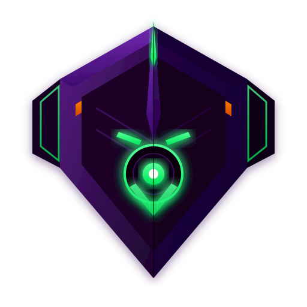

<p align="center">
  
</p>

<h1 align="center">EVA-01</h1>

## How it works

EVA-01 is an AI desktop assistant that watches your screen, understands your task, and helps you complete it on the computer.

It can:
- see what is on screen
- understand the context of your work
- click, type, and navigate on your desktop
- work with local or cloud AI models
- help with automation and task execution

## Install

### Requirements
- Node.js 20+
- Yarn 1.22+

### Steps
```bash
git clone https://github.com/dortanes/eva-01.git
cd eva-01
yarn install
yarn dev
```

Then open the app and configure your AI provider in the app settings.

## Contribute

Contributions are welcome.

1. Fork the repository
2. Create a feature branch
3. Make your changes
4. Open a pull request

If you find a bug or want to suggest an improvement, open an issue first.
