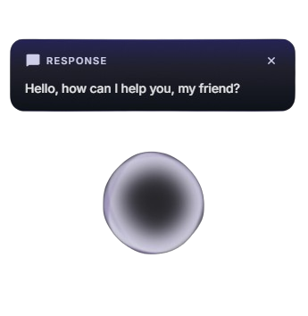

<p align="center">
  
</p>

<h1 align="center">EVA-01</h1>

<p align="center">
  <b>AI agent that lives on your desktop.</b><br/>
  It sees your screen, understands what you need, and gets things done — hands-free.
</p>

<p align="center">
  <a href="https://github.com/dortanes/eva-01/releases"></a>&nbsp;
  <a href="#-getting-started"></a>&nbsp;
  <a href="LICENSE"></a>
</p>

<p align="center">
  
  
  
</p>

<p align="center"></p>

---

> **⚠️ EVA-01 is in active development (v0.2.3).**
> 
> - 🤖 **LLM support:** Gemini (including native [Computer Use API](https://ai.google.dev/gemini-api/docs/computer-use)), Local LLMs (Ollama, LM Studio, vLLM, llama.cpp), and OpenAI.
> - 🎙 **Voice & Audio:** Microphone & speaker device configuration, offline Whisper flow, and lightweight Vosk wake word.
> - 🖥 **Screen control:** Gemini 3.x models use native [Computer Use API](https://ai.google.dev/gemini-api/docs/computer-use) for precise actions. Older models use vision-based coordinate prediction.
> - 💻 **Platform:** Windows only for now. macOS & Linux support is planned.
> - 🐛 **Found a bug?** We'd love to hear about it — [open an issue](https://github.com/dortanes/eva-01/issues).

---

## What is EVA-01?

EVA-01 is an **AI-powered desktop agent** that works alongside you as a transparent overlay. Press `Ctrl+Space`, tell it what to do — and it figures out the rest: navigating apps, clicking buttons, typing text, searching the web, finding files, running commands.

Think of it as a **copilot for your entire OS**.

- 🖥 **Sees your screen** — captures what's on your display and understands the context
- 🧠 **Thinks before it acts** — plans multi-step tasks and shows progress in real time
- 🖱 **Controls your computer** — mouse, keyboard, and terminal — all automated
- 🎯 **Shows what it's doing** — you can see the agent's cursor moving on screen
- 🔍 **Searches the web** — finds answers and brings them back, no tab-switching needed
- 📂 **Finds your files** — searches local files and folders by name, right from chat
- 🗣 **Speaks to you** — real-time voice responses with streaming TTS and selectable speaker output
- 🎙 **Listens to you** — local offline Whisper speech-to-text with wake word activation, no cloud required
- 🔊 **Sound feedback** — distinct sounds for every state: activation, processing, task complete, warnings
- 🛡 **Asks before doing anything risky** — built-in safety system with permission prompts

---

## ✨ Key Features

### 🔮 The Orb
A glowing AI indicator that shows you exactly what EVA-01 is doing — idle, thinking, acting, or waiting for your input. Always visible, never in the way.

### 🏝 Islands
Context-aware floating panels that appear when relevant:
- **Action Island** — shows the current task and progress
- **Response Island** — streams EVA-01's thoughts and replies word by word
- **Permission Island** — asks for confirmation before risky operations
- **Microtask Island** — your task queue with real-time step progress (queue new tasks while the agent is busy)
- **Search Island** — web search results and local file search results
- **Listening Island** — live transcript display during voice input
- **Warning Island** — dismissable warnings for errors and quota issues

### 🎯 Agent Cursor
When EVA-01 controls your desktop, you can see its cursor moving on screen — clicking, typing, and scrolling — so you always know what's happening.

### 🖥 Computer Use
With compatible Gemini 3.x models, EVA-01 uses the native **[Computer Use API](https://ai.google.dev/gemini-api/docs/computer-use)** for precise screen control — clicking, typing, scrolling, navigating, and searching — all without opening extra apps. Multi-monitor setups are supported.

### 🧩 Smart Task Planning
Before executing complex commands, EVA-01 breaks them into high-level steps (2–5) and displays them in the Task Queue. You see planned steps before execution begins and watch progress as each step completes.

### 🎭 Personas
Create multiple AI agents with unique personalities, knowledge, and voices. Each persona has its own memory and prompt settings — switch between them from the tray menu.

### 🧠 Memory
EVA-01 remembers your preferences and context across sessions. It learns facts about you from conversations and uses them to give better responses over time. Browse conversation history and view, edit, or delete learned facts in Settings.

### 🎙 Audio Hardware & Offline Whisper
Configure specific microphone and speaker output devices. Choose between lightweight Vosk wake word, high-accuracy offline Whisper flow, or hybrid mode (Vosk wake detection + offline Whisper transcription).

### ✍️ Editable Prompts
Full control over the AI's behavior — modify system, action, and safety prompts directly from the Settings UI. Reset to defaults anytime.

### ⚙️ Customizable Layout
Choose where EVA-01 appears on screen (left, right, or center) and configure your preferred activation hotkey — all from Settings.

### 🔧 Debug Logging
Enable per-request session logs to trace the full pipeline: intent classification → LLM calls → actions → response streaming — with precise timing for every stage.

---

## 🚀 Getting Started

### Download & Install

1. Go to [**Releases**](https://github.com/dortanes/eva-01/releases) and download the latest installer for Windows
2. Run the installer — EVA-01 will appear in your system tray
3. Configure your LLM:
   - **Local LLM**: In **Settings** → **Intelligence** tab → select **Local LLM** → choose preset (Ollama, LM Studio, vLLM) → click **Test & Fetch Models**
   - **Gemini**: Go to [Google AI Studio](https://aistudio.google.com/apikey) → sign in → **Create API Key** → paste into **Settings** → **Intelligence**
4. Press `Ctrl+Space` and start giving EVA-01 tasks 🎉

### Build from Source

> For contributors and developers who want to run EVA-01 from source.

```bash
git clone https://github.com/dortanes/eva-01.git
cd eva-01
yarn install
yarn dev
```

> **Requires:** [Node.js](https://nodejs.org/) ≥ 20 · [Yarn](https://yarnpkg.com/) ≥ 1.22

---

## 🗺 Roadmap

| Status | Feature |
|:------:|---------|
| ✅ | Transparent glassmorphism overlay with Orb + Island UI |
| ✅ | LLM integration (Gemini + Local LLM / OpenAI-compatible) with presets & auto-discovery |
| ✅ | Offline Whisper flow + hybrid wake word speech recognition |
| ✅ | Microphone and speaker hardware configuration with live VU metering |
| ✅ | Screen vision + desktop automation (robotjs) |
| ✅ | Native Gemini [Computer Use API](https://ai.google.dev/gemini-api/docs/computer-use) |
| ✅ | Smart task planning with step-by-step progress |
| ✅ | Agent cursor animations (click, type, scroll overlays) |
| ✅ | Streaming TTS (ElevenLabs + Alice) |
| ✅ | Persona system with isolated memory & custom voices |
| ✅ | Web search + local file search |
| ✅ | Settings UI with prompt editor + debug logging |
| ✅ | Intent classification (direct / action / chat) |
| ✅ | Context caching (Gemini prompt caching for token optimization) |
| 🔜 | Action whitelist/blacklist & audit log |
| 🔜 | Onboarding flow |
| 🔜 | Auto-update |

---

## ⭐ Support the Project

If you find EVA-01 useful, please consider giving the repository a **star** ⭐ — it helps others discover the project and motivates further development!

[](https://github.com/dortanes/eva-01)

## 🤝 Contributing

Contributions are welcome! Feel free to open an issue or submit a pull request.

## 📜 License

[Apache License 2.0](LICENSE) — use it, modify it, build on it.

---

<p align="center">
  Vibecoded with ❤️ by <a href="https://github.com/dortanes">dortanes</a>
</p>