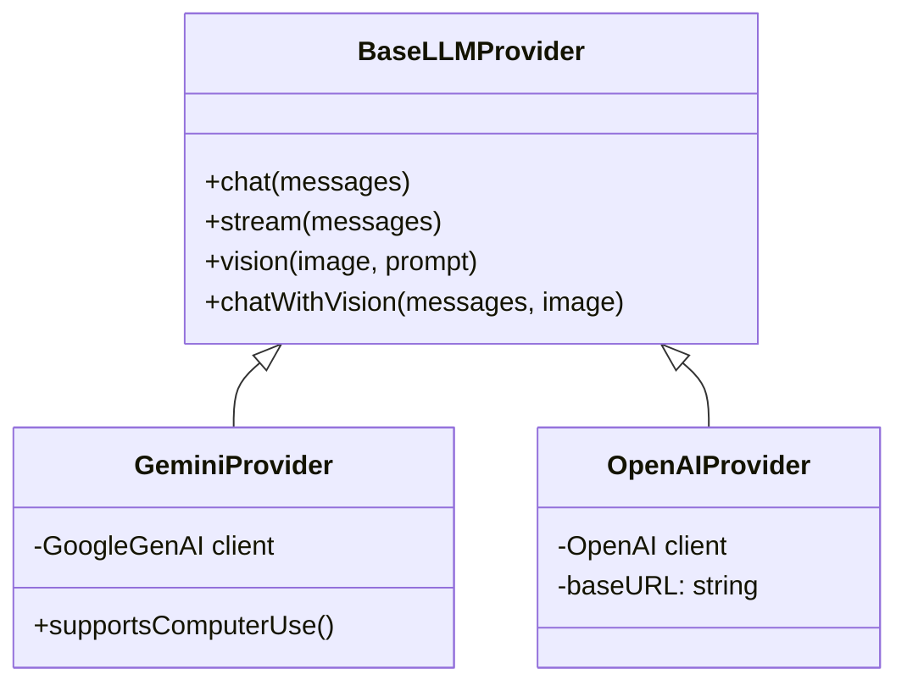

# EVA-01 System Architecture

This document provides a comprehensive technical breakdown of **EVA-01**, an AI-powered desktop agent built with Electron, Vue 3, and hybrid local/cloud neural intelligence.

---

## 1. High-Level System Topology

```mermaid
graph TD
    subgraph OS ["Operating System & Hardware"]
        MIC[Microphone / Audio Input]
        SPK[Speaker / Audio Output]
        GPU[GPU / VRAM - NVIDIA, AMD, Intel]
        SCR[Display / Screen Capture]
        ACT[OS Mouse & Keyboard Input]
        HOT[Global OS Key Hooks]
    end

    subgraph Renderer ["Electron Renderer Process (Vue 3)"]
        UI[UI Overlay & Islands]
        AW[AudioWorklet: 16kHz PCM Stream]
        VOSK[Vosk WASM: Lightweight Wake Word]
        SND[Web Audio SFX Engine]
        STT_COMP[useSTT Composable & Pre-roll Buffer]
    end

    subgraph Main ["Electron Main Process (Node.js & Native C++)"]
        TRPC[tRPC Routers: Audio, System, LLM, Agent]
        EB[EventBus: Async Decoupled Events]
        SR[Service Registry]
        
        subgraph Services ["Backend Core Services"]
            GPU_SVC[GPUService: Hardware Detection & Acceleration]
            STT_SVC[STTService: Embedded Whisper ONNX / Cloud Whisper]
            TTS_SVC[TTSService: Multi-Accent Neural / Alice / ElevenLabs]
            INT_SVC[IntelligenceService: Multi-Provider LLM]
            AGT_SVC[AgentService: Autonomous Loop & Tool Calling]
            VIS_SVC[VisionService: Screenshot Capture & Normalization]
            MOT_SVC[MotorService: Mouse & Keyboard Actuation]
            MEM_SVC[MemoryService & FactService: SQLite Persistence]
            HOT_SVC[HotkeyService: Global Shortcut Hooks]
        end
    end

    subgraph LocalCloud ["LLM & STT Engines"]
        OLLAMA[Local Ollama / LM Studio (GPU CUDA Offload)]
        GEMINI[Google Gemini API]
        CLOUD_WHISPER[External Whisper API]
    end

    %% Audio & Voice Connections
    MIC --> AW
    AW --> VOSK
    AW --> STT_COMP
    VOSK -- Wake Word Detected --> STT_COMP
    STT_COMP -- Instant Wake SFX --> SND
    SND --> SPK
    STT_COMP -- Audio Buffer via tRPC --> STT_SVC
    STT_SVC --> GPU_SVC
    TTS_SVC -- Audio Stream --> EB
    EB --> SND

    %% Intelligence & Agent Loop
    STT_SVC -- Transcribed Text --> AGT_SVC
    AGT_SVC --> INT_SVC
    INT_SVC --> OLLAMA
    INT_SVC --> GEMINI
    AGT_SVC --> VIS_SVC
    VIS_SVC --> SCR
    AGT_SVC --> MOT_SVC
    MOT_SVC --> ACT
    HOT --> HOT_SVC
    HOT_SVC --> EB
```

---

## 2. Process Boundaries & Inter-Process Communication (IPC)

EVA-01 maintains a strict separation of concerns between processes to ensure desktop responsiveness, security, and low latency:

| Process | Runtime | Responsibilities | Communication |
| :--- | :--- | :--- | :--- |
| **Renderer Process** | Chromium / Vue 3 / TypeScript | Glassmorphic overlay UI, dynamic islands, high-fps audio meters, Web Audio SFX, and Vosk browser WASM. | Communicates exclusively with Main via **type-safe tRPC** queries, mutations, and reactive subscriptions. |
| **Main Process** | Node.js / Native Addons (`@hurdlegroup/robotjs`, `uiohook-napi`) | Window orchestration, OS system calls, screen capture, hardware discovery, audio decoding, and SQLite storage. | Hosts the tRPC Server and central `mainEventBus` (`EventEmitter`). |
| **Worklet Thread** | AudioWorklet Processor | Extracts raw audio chunks from `getUserMedia` off the UI thread to guarantee zero frame drops during UI animations. | MessagePort to Vue composable. |

---

## 3. Realtime Audio & Voice Pipeline (Low-Latency Hybrid)

The voice system uses a **two-stage hybrid architecture** optimized for responsiveness and offline privacy:

### Stage 1: Continuous Zero-Cost Wake Word Listening
- **Vosk WASM**: A small Kaldi-based acoustic model runs continuously in the browser thread using WebAssembly.
- **CPU Footprint**: Consumes under **1% CPU** during idle listening.
- **Pre-roll Rolling Buffer**: While in idle mode, an internal rolling buffer stores the last **2.0 seconds** of audio samples. When the wake word is spoken (e.g., *"EVA-01, click Start"*), the audio preceding and during the wake word is retained so no words are clipped.

### Stage 2: Instant Activation & Audio Feedback
- **Zero-Latency Audio Cue**: The moment Vosk matches the wake word, `useSounds().activate()` plays an instant audio chime, giving immediate tactical confirmation before network or heavy model inference begins.
- **Echo Suppression & TTS Guard**: Whenever EVA-01 speaks or during room reverberation (1.0s window post-speech), microphone samples are automatically dropped to prevent acoustic feedback loops.

### Stage 3: Low-Latency Silence Cutoff
- **Adaptive Silence Thresholds**:
  - `SILENCE_BASE = 450ms`: For sentences and complex commands.
  - `SILENCE_MAX = 750ms`: For short utterances.
  - *Result*: Shaves off over **750ms** of dead silence waiting compared to standard voice assistants.

### Stage 4: High-Accuracy Whisper Transcription
- **Pre-warmed ONNX Runtime**: Embedded Whisper (`@xenova/transformers`) is pre-warmed during app startup (`stt.prewarm()`). ONNX execution sessions and memory graphs remain resident in RAM.
- **Multi-Threaded SIMD Acceleration**: Configured to utilize up to 8 native CPU threads with hardware vector SIMD (`env.backends.onnx.wasm.simd = true`).
- **Cloud / Local Server Fallback**: Option to route audio directly to local or cloud Whisper endpoints (OpenAI, Groq, or `faster-whisper-server`).

---

## 4. Hardware Detection & GPU Acceleration

EVA-01 dynamically adapts to host graphics capabilities via `GPUService`:

1. **Hardware Discovery**:
   - On Windows, queries `Win32_VideoController` via CIM and inspects NVIDIA drivers (`nvidia-smi`) for dedicated VRAM capacity.
   - Detects GPU vendor, total VRAM, and driver release versions.
2. **Chromium Hardware Flags**:
   - Initialized before app ready:
     - `enable-gpu-rasterization`: Accelerates glassmorphism, blur shaders, and layout repaints directly on the GPU.
     - `enable-zero-copy`: Minimizes memory copies between video decoder and compositor.
     - `ignore-gpu-blocklist`: Unlocks hardware video decode/encode on modern cards.
3. **Local AI Model Sizing Guide**:
   - Computes recommended model quantizations based on installed VRAM:
     - **&ge; 16 GB VRAM**: Full offload for 14B–32B Q4/Q5 models.
     - **8–12 GB VRAM**: Full offload for 7B–8B models (e.g. `llama3.1:8b`, `mistral:7b`, `qwen2.5-coder:7b`).
     - **3.5–6 GB VRAM** (e.g. RTX 2050): Optimal for 3B–7B Q4 models (e.g. `llama3.2:3b`, `qwen2.5:3b`).
     - **&lt; 3 GB / Integrated**: Recommended for 1B–3B quantized models with CPU offloading.

---

## 5. Intelligence & Local Model Execution

EVA-01 supports both cloud and local model runners through a unified interface:



- **🦙 Ollama Integration**: Connects to `http://localhost:11434/v1` with zero API key required. Queries local model tags (`/api/tags`) for 1-click model selection.
- **🧪 LM Studio Integration**: Connects to `http://localhost:1234/v1` for local model hosting with GPU offloading.
- **✨ Google Gemini**: Used for cloud reasoning, large context windows (up to 1M tokens), and native Computer Use function calling.
- **Context Caching**: Implements Gemini context caching for system instructions, reducing prompt token costs and latency by up to 80%.

---

## 6. Vision & Motor Actuation Loop

For autonomous computer use:
1. **Screen Capture**: `VisionService` captures desktop frames using native OS screenshot APIs.
2. **Coordinate Normalization**: Translates between screen resolution coordinates and model vision resolution coordinates, taking OS DPI scaling into account.
3. **Action Execution**: `MotorService` executes clicks, drags, mouse scrolls, and keyboard keystrokes via native bindings (`robotjs`).
4. **Safety Verification**: High-risk actions trigger a Permission Request modal with preview coordinates before execution.
